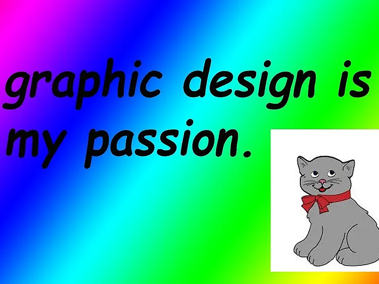

## About This Blog

There's nothing special about this blog, it's just a place to save my reflections and host JavaScript snippets.

However, there *is* something special about the theme:

- The navbar was inspired by [probberechts/hexo-theme-cactus](https://github.com/probberechts/hexo-theme-cactus) and [Blackle Mori](https://www.blackle-mori.com/projects/nge-parody/)
- The `Writings/timeline` logic was inspired by [saicaca/fuwari](https://github.com/saicaca/fuwari)
- Some assets were recreated from [PAMS' PALACE on GeoCities](https://geocities.restorativland.org/SoHo/1045/) and [cyber.dabamos.de](https://cyber.dabamos.de/index.html)

Good artists copy, great artists steal. Why reinvent the wheel when you can just steal? 😼

Apart from the borrowed aesthetics, I also added a few extensions:

- KaTeX support via [KaTeX](https://katex.org/), like this: $E = mc^2$
- Mermaid UML diagrams
- Code syntax highlighting:

```nix
# floral-cities syntax highlighting check
let
  vibe = [ "geocities" "hci" "nix" ];
  steal = x: "borrowed from ${x}";
in
{
  theme = "floral-cities";
  uglyOnPurpose = true;
  heuristics = 10;
  inspo = map steal vibe;
}
```

Learn more about this theme at <https://github.com/fractuscontext/hugo-theme-floral-cities>

## About Me



I study Software Engineering, and in my spare time I also explore Human-Computer Interaction (HCI) and read about psychology.

This site originally started out as an attempt to design a website as ugly as possible while users still know how to use it (and while adhering to Nielsen Norman’s 10 Usability Heuristics), and ended up being to be over-engineered.

If you have questions about, well, anything, find me on [/gh/](https://github.com/fractuscontext), or <a href="#" id="getEmail">click here to reveal my email</a> (JavaScript required, or inspect the page source).

<script>
  const getEmailEl = document.querySelector('#getEmail');
  const b64Email = 'Y2xhaXJlMjAyNnQgW2F0XSBwb3N0ZW8gW2RvdF0gbmV0';

  getEmailEl.addEventListener('click', (event) => {
    event.preventDefault();
    getEmailEl.replaceWith(document.createTextNode(atob(b64Email)));
  });
</script>
