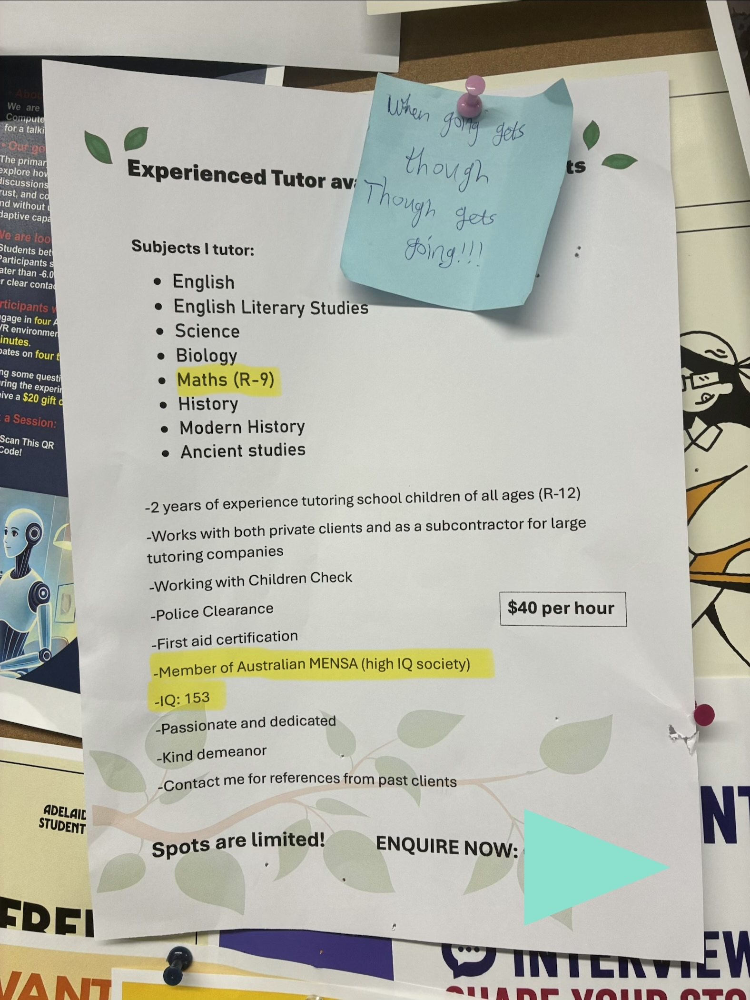
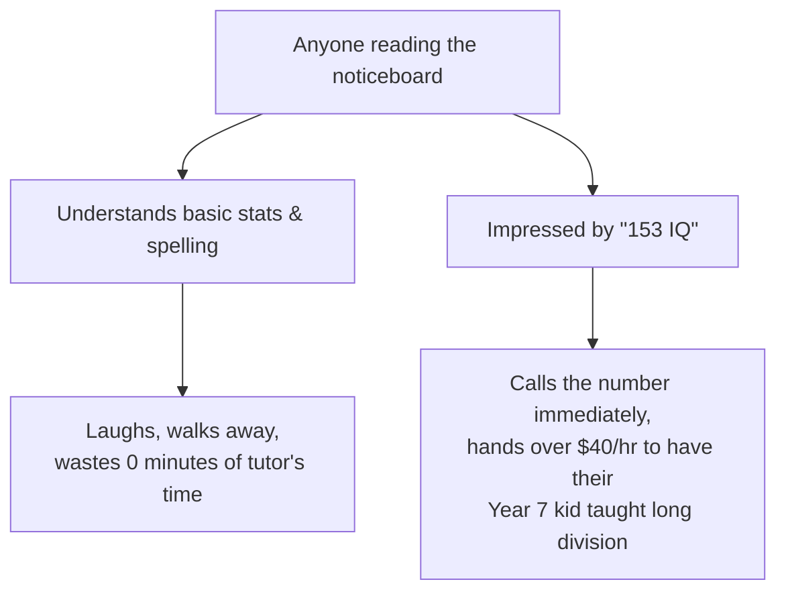

Stats is quite entertaining because it reminds me of Year 10 maths, where everyone collectively agreed that if you flip a coin four times and get Heads every single time, Tails is somehow "due".

## Probability of Bird Poop

A classic urban myth goes something like this: if a bin chicken drops "heavy assets" onto your forehead (like a LinkedIn B2B sales specialist), what is the probability of getting hit a second time?

Most people would wipe their brow, shrug, and say:
> *"Welp, at least that’s out of the way! Mathematically speaking, the odds of getting hit twice in a lifetime are practically zero!"*

I have no idea who convinced the general public of this, because every bird encounter is an independent event. The digestive tract of a bin chicken hovering over North Terrace today does not communicate with the seagull stalking your hot chips tomorrow.

Congrats! You just reinvented the Gambler's Fallacy, and conditional probability would like a word. Since the two hits are independent, the first one tells you absolutely nothing about the second:

$$P(B \mid A) = \frac{P(A \cap B)}{P(A)} = \frac{P(A) \cdot P(B)}{P(A)} = P(B)$$

## 1% Chance of becoming a girl

Consider the canonical internet dilemma that periodically circulates through Discord servers at 3 am:

Most guys look at this and go:
> *"bruh, I'm a very cis dude, I'm just gonna smash this button 50 times, walk away with $50,000,000."* 🥚

Let $p = 0.01$ be the probability of triggering the gender swap on any single press. The probability of surviving a single press *without* transforming is:

$$q = 1 - p = 0.99$$

Because each press is an independent Bernoulli trial, the probability of surviving $n$ consecutive presses without transforming is $q^n$:

* 1 press: $0.99^1 = 99.0\%$ chance you remain a boy.
* 10 presses: $0.99^{10} \approx 90.4\%$ chance. *(Still feeling confident.)*
* 50 presses: $0.99^{50} \approx 60.5\%$ chance. *(Sweating slightly.)*
* 69 presses: $0.99^{69} \approx 49.9\%$ chance.
* 100 presses: $0.99^{100} \approx 36.6\%$ chance.
* 500 presses: $0.99^{500} \approx 0.66\%$ chance. 🎀

If you press the button an infinite number of times:

$$\lim_{n \to \infty} (1 - p)^n = 0 \quad \implies \quad \lim_{n \to \infty} P(\text{Girl}) = 1.0$$

As your financial greed approaches infinity, the probability of avoiding that 1% outcome collapses to absolute zero.

If you keep spamming the button to fund your custom homelab server rack, you are mathematically guaranteed to end up sitting in your flat wearing an oversized pastel hoodie, staring at an incomprehensibly large bank balance. That is how cumulative probability works.

### Monkeys, Dadaism, and Combinatorial Violence

The infinite monkey theorem goes like this: given infinite time and a mechanical typewriter, a chimpanzee hitting random keys will eventually type out Shakespeare’s *Hamlet*, followed immediately by the entire Linux kernel source code and a scathing critique of your lifestyle choices.

It is a bit similar to what the Dadaists stumbled into during the 1920s: Tristan Tzara cutting words out of a newspaper, dumping them into a top hat, shaking the hat, and pulling them out one by one to create "poetry". Statistically speaking, if you shake that hat long enough, you will eventually reconstruct the Universal Declaration of Human Rights.

There are about 8 billion people on Earth. A standard 52-card deck, on the other hand, can be shuffled into

$$52! \approx 8.07 \times 10^{67}$$

different orders, more than the roughly $10^{50}$ atoms that make up the planet. Shuffle a deck properly, and the order in your hands has almost certainly never existed before and never will again.

Yet people take one look at MBTI personality tests or Hofstede’s Cultural Dimensions and go:
> *"Ah yes, 8 billion distinct human consciousnesses can definitely be bucketed into 16 discrete psychological archetypes based on a 20-question Buzzfeed-tier survey."*

The ecological fallacy is laughing at us from the rafters.

### The Worst Tutoring Ad I've Ever Seen

There are so many layers that I don't even know where to start:

1. The IQ Claim: The author advertises an IQ of 153.
   * Standardised psychometric tests (like the WAIS-IV) are normed with $\mu = 100$ and $\sigma = 15$.
   * An IQ of 153 represents a score $+3.53\sigma$ above the mean.
   * That places you in the top $0.02\%$ of the global human population—roughly 1 in every 5,000 people.
   * At that altitude, standard psychometric tests hit the ceiling effect: the standard error of measurement balloons, and the test literally runs out of discriminative power. Claiming a precise score of "153" on a public noticeboard is psychometrically meaningless chest-thumping.

2. The Curriculum Scope:
   * This self-proclaimed top 0.02% galactic megamind, blessed with a 153 IQ, has decided to deploy their cosmic intellect to tutor... maths up to Year 9. 💀
   * You possess an Einstein-tier intellect, and your operational domain caps out at solving $2x + 5 = 15$ and explaining what a hypotenuse is to a 14-year-old?

I guess it's the same logic as Nigerian prince scams. A polished email gets replies from smart people who waste the scammer's time and never pay; a badly written, absurd one filters them out so only the most gullible reply. [Cormac Herley](https://www.microsoft.com/en-us/research/publication/why-do-nigerian-scammers-say-they-are-from-nigeria/) framed this as cutting false positives, and the flyer works the same way:

If you understand standard deviations, you walk past the flyer. If you don't know what $\sigma$ means and you think Mensa is a prestigious guild of sorcerers rather than a $90/year subscription fee for people who like Sudoku puzzles, you pull out your phone and dial the number.

Perhaps it's not bad advertising; it's a perfectly calibrated, mathematically optimal self-filtering funnel.
